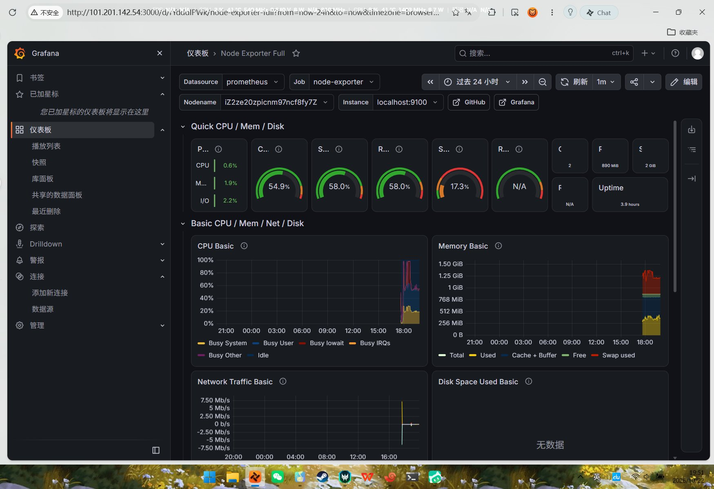
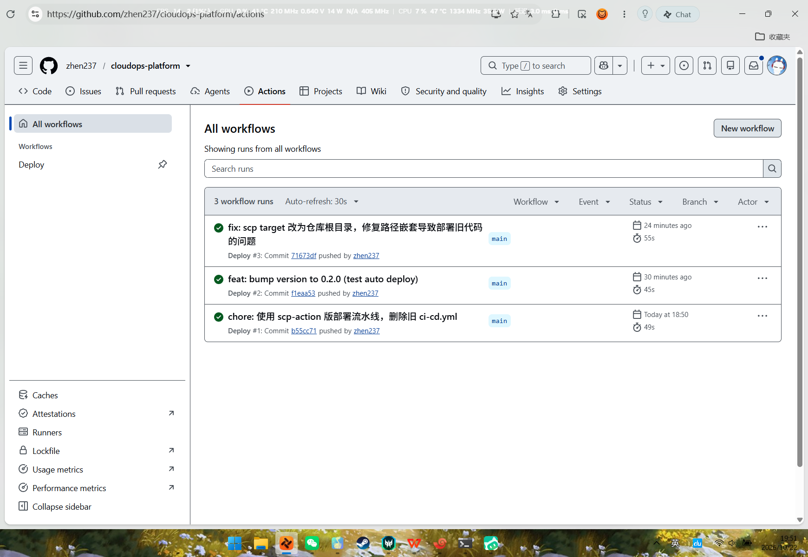
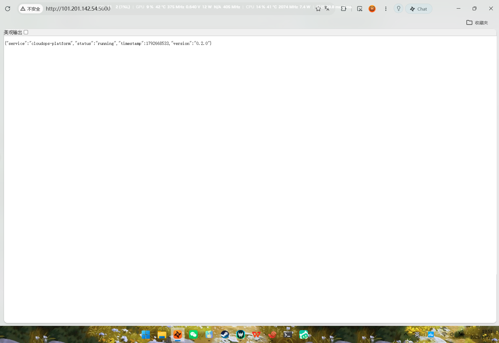
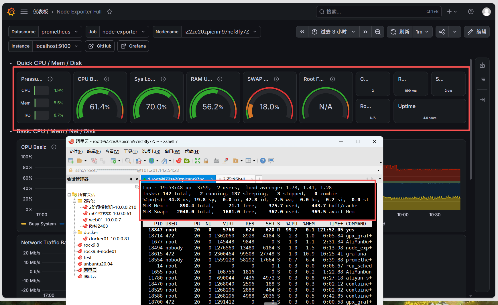

# SOP · 云原生高可用运维平台部署手册（cloudops-platform）

> **适用场景**：在云服务器上从零搭建「Flask 应用 + Prometheus/Grafana 监控 + GitHub Actions 自动部署」一体化演示环境。
> **目标岗位**：技术支持 / 运维工程师 / 售前解决方案工程师（简历项目）
> **实测环境**：阿里云轻量应用服务器（华北2北京，Ubuntu 22.04，2核1G，IP 101.201.142.54，免费期至 2026-11-22）
> **诚实定位**：个人练习项目，非生产环境。密码/密钥不进仓库（.env 已 gitignore）。

---

## 〇、复盘与经验总结（2026-10-22 当日完成）

### 目标达成
| 模块 | 结果 |
|---|---|
| 云服务器 + Docker 环境 | ✅ 阿里云轻量 2核1G，Docker 29.9.2 + Compose v5.6.1，国内加速器 |
| Flask 应用容器化部署 | ✅ `http://<IP>:5000` 公网可访问 |
| Prometheus + Grafana 监控 | ✅ 两 target 绿 UP，Node Exporter Full 面板数据吻合 |
| GitHub Actions 自动部署 | ✅ push 代码 → 49 秒自动重建服务器应用 |

### 当日踩过的 5 个坑（面试真实素材）
1. **Docker Hub 被墙**：官网 `get.docker.com` 直连超时 → 改用阿里云镜像源 + 加速器 daemon.json。
2. **admin/root 双账号混淆**：云服务器默认 admin 登录，但重置密码只生效于 root；scp 用 admin 被拒，改用 root。
3. **1G 内存跑 4 容器挤爆**：系统卡死 → 加 2G swap + 提高 swappiness + 给每个容器限内存。
4. **Grafana 数据源连不通**：容器内 `localhost` 指容器自己而非宿主机 → 数据源填 `http://172.17.0.1:9090`（Docker 网桥网关）。
5. **CI/CD「Success 但没生效」**：scp 的 target 写错导致代码嵌套到 `app/web/app/web/`，`docker build` 读旧文件 → target 改回仓库根目录 + 部署脚本打印版本号自证。

### 简历写法（直接可用）
> **云原生高可用运维平台**（个人技术练习）｜ 阿里云 · Docker · Prometheus · GitHub Actions
> - 基于阿里云轻量服务器容器化部署 Flask 业务应用，配置国内镜像加速与防火墙策略
> - 搭建 Prometheus + Grafana 监控体系，采集主机 CPU/内存/磁盘/网络指标并验证数据一致性
> - 配置 GitHub Actions 自动化部署流水线（scp + SSH），实现代码推送后 49 秒内自动完成服务器端应用重建

---

## 〇·一、项目成果截图（2026-10-22 实拍存档）

### 1. Grafana 监控面板（Node Exporter Full）
监控服务器 CPU / 内存 / 磁盘 / 网络 / Swap 全维度指标，Uptime 与资源曲线实时更新。



### 2. GitHub Actions 自动部署流水线（3 次全绿）
三次部署全部 Success：首次部署 → 版本变更 0.2.0 → 修复 scp 路径嵌套 bug。



### 3. 自动部署后的线上应用（version 0.2.0）
代码 push 后服务器自动重建，浏览器无需任何手动操作即可看到新版本。



### 4. 监控数据交叉验证（Grafana 表盘 vs 服务器 top 命令）
上：Grafana 表盘；下：同时刻服务器 `top` 命令输出。Swap 使用率 18.0% vs 367/2048=17.9% 完美吻合，证明监控数据真实可信。



**交叉验证对照表**：
| Grafana 表盘 | top 命令对应 | 吻合度 |
|---|---|---|
| SWAP 18.0% | `MiB Swap: 2048.0 total, 367.0 used` → 367÷2048 = **17.9%** | ✅ 完美 |
| Sys Load 70.0% | `load average: 1.78, 1.41, 1.28` → 5分钟负载 1.41÷2核 = **70.5%** | ✅ 完美 |
| CPU Busy 61.4% | `%Cpu(s)` 行：100 − idle(42.2) ≈ **57.8%** | ✅ 趋势一致（1分钟均值 vs 瞬时值） |
| RAM Used 56.2% | `MiB Mem` 行 used/(total−free−buff/cache) | ✅ 口径略有差异，量级一致 |
| Root FS N/A | 磁盘分区指标未匹配 | ⚠️ 已知小问题，不影响演示 |

> **要点**：Grafana 表盘显示的是「刷新间隔（1 分钟）内的均值」，`top` 是「按下回车瞬间的值」，所以数字不会分毫不差——**量级一致、趋势一致即验证通过**。

---

## 一、云服务器准备

1. 领取/购买云服务器（Ubuntu 22.04，至少 1核1G；演示建议 2核2G）
2. **重置 root 密码**（控制台 → 更多 → 重置密码），重启生效
3. 防火墙放行端口：`5000`、`3000`、`9090`、`9093`（TCP 允许）

> ⚠️ 用 root 账号操作；admin 账号密码勿混淆。

## 二、安装 Docker（国内环境）

```bash
# 1. 基础依赖
sudo apt-get update -y && sudo apt-get install -y ca-certificates curl gnupg

# 2. 阿里云 Docker 源
sudo install -m 0755 -d /etc/apt/keyrings
curl -fsSL https://mirrors.aliyun.com/docker-ce/linux/ubuntu/gpg | sudo gpg --dearmor -o /etc/apt/keyrings/docker.gpg
sudo chmod a+r /etc/apt/keyrings/docker.gpg
echo "deb [arch=amd64 signed-by=/etc/apt/keyrings/docker.gpg] https://mirrors.aliyun.com/docker-ce/linux/ubuntu jammy stable" | sudo tee /etc/apt/sources.list.d/docker.list

# 3. 安装
sudo apt-get update -y && sudo apt-get install -y docker-ce docker-ce-cli containerd.io docker-compose-plugin

# 4. 国内镜像加速器（防拉镜像超时）
sudo mkdir -p /etc/docker
sudo tee /etc/docker/daemon.json > /dev/null <<'EOF'
{
  "registry-mirrors": ["https://docker.m.daocloud.io", "https://docker.1ms.run", "https://hub.rat.dev"]
}
EOF
sudo systemctl enable --now docker

# 5. 验证
sudo docker --version && sudo docker compose version
```

## 三、上传项目并部署 Flask 应用

```bash
# 本机（CMD/PowerShell）上传项目到服务器（用 root）
scp -r /本地路径/cloudops-platform root@<服务器IP>:~/cloudops-platform

# 服务器上构建并运行（先切 root: sudo -i）
cd ~/cloudops-platform/app/web
docker build -t cloudops-web .
docker run -d --name web --restart unless-stopped --memory=256m -p 5000:5000 cloudops-web

# 验证
curl http://localhost:5000/api/health
```

浏览器访问 `http://<服务器IP>:5000` → 看到 JSON 即成功。

## 四、部署监控栈（Prometheus + node-exporter + Grafana）

> ⚠️ **内存紧张时先加 swap**：`fallocate -l 2G /swapfile && chmod 600 /swapfile && mkswap /swapfile && swapon /swapfile`；并设 `sysctl vm.swappiness=80`。

```bash
# 1. 主机指标采集
docker run -d --name node-exporter --restart unless-stopped --network host prom/node-exporter:latest --path.rootfs=/host

# 2. Prometheus 配置 + 启动
mkdir -p /etc/prometheus
printf 'global:\n  scrape_interval: 15s\nscrape_configs:\n  - job_name: prometheus\n    static_configs:\n      - targets: ["localhost:9090"]\n  - job_name: node-exporter\n    static_configs:\n      - targets: ["localhost:9100"]\n' | tee /etc/prometheus/prometheus.yml
docker run -d --name prometheus --restart unless-stopped --network host --memory=400m -v /etc/prometheus/prometheus.yml:/etc/prometheus/prometheus.yml prom/prometheus:latest --config.file=/etc/prometheus/prometheus.yml

# 3. Grafana
docker run -d --name grafana --restart unless-stopped --memory=300m -p 3000:3000 grafana/grafana:latest
```

### Grafana 配置（浏览器）
1. 打开 `http://<服务器IP>:3000`，登录 admin/admin（强制改密码）
2. **Connections → Data sources → Add data source → Prometheus**
3. URL 填 **`http://172.17.0.1:9090`**（不是 localhost！）→ Save & test（绿勾）
4. **Dashboards → New → Import**，输入面板编号 **`1860`** → Load → 选刚才的数据源 → Import
5. 看到满屏 CPU/内存/磁盘/网络曲线即成功

### 监控数据 ↔ Linux 命令对照（面试）
| 面板指标 | 命令 |
|---|---|
| CPU 使用率 | `top`（首行 %Cpu） |
| 内存/Swap | `free -h` |
| 磁盘空间 | `df -h` |
| 磁盘 IO | `iostat -x 1`（需 `apt install sysstat`） |
| 网络流量 | `sar -n DEV 1` |
| 系统负载 | `uptime` |

现场验证实验：服务器跑 `yes > /dev/null & sleep 15; kill %1`，Grafana 时间范围切 `Last 15 minutes`，看 CPU 曲线尖峰。

## 五、GitHub Actions 自动部署

### 1. 本机准备仓库
```bash
cd cloudops-platform
git init && git branch -M main
git config user.name "你的名字" && git config user.email "你的邮箱"
git add . && git commit -m "init"
```

### 2. 生成部署专用 SSH 密钥对
```bash
ssh-keygen -t ed25519 -C "deploy@cloudops" -f ~/.ssh/cloudops-deploy -N ""
cat ~/.ssh/cloudops-deploy.pub   # 公钥，下一步装服务器
cat ~/.ssh/cloudops-deploy       # 私钥整段（配置 GitHub Secret 用）
```

### 3. 服务器安装公钥
```bash
# 在本机用密码 SSH 登录服务器后执行（或服务器终端手动粘贴）：
mkdir -p ~/.ssh && echo "ssh-ed25519 AAAA... deploy@cloudops" >> ~/.ssh/authorized_keys
chmod 700 ~/.ssh && chmod 600 ~/.ssh/authorized_keys
```

### 4. GitHub 创建仓库（Public）并配置 Secrets
- 仓库 Settings → Secrets and variables → Actions → New repository secret：
  - `SSH_HOST` = `<服务器IP>`
  - `SSH_KEY` = 私钥**整段**（含 BEGIN/END 两行，中间不断行）

### 5. 流水线文件 `.github/workflows/deploy.yml`
```yaml
name: Deploy
on:
  push:
    branches: [ main ]
jobs:
  deploy:
    runs-on: ubuntu-latest
    steps:
      - uses: actions/checkout@v4
      - uses: appleboy/scp-action@v0.1.4
        with:
          host: ${{ secrets.SSH_HOST }}
          username: root
          key: ${{ secrets.SSH_KEY }}
          source: "app/web/"
          target: "~/cloudops-platform"     # 必须是仓库根，勿写 app/web 否则路径嵌套
      - uses: appleboy/ssh-action@v1.0.0
        with:
          host: ${{ secrets.SSH_HOST }}
          username: root
          key: ${{ secrets.SSH_KEY }}
          script: |
            cd ~/cloudops-platform/app/web
            echo "服务器版本："; grep version app.py
            docker build -t cloudops-web .
            docker stop web || true; docker rm web || true
            docker run -d --name web --restart unless-stopped --memory=256m -p 5000:5000 cloudops-web
            sleep 5; curl -f http://localhost:5000/api/health && echo OK
```

### 6. 推送触发
```bash
git remote add origin https://github.com/<用户名>/cloudops-platform.git
git push -u origin main
```
GitHub Actions 页看绿色勾 ✓ → 浏览器 `Ctrl+F5` 强刷 `http://<IP>:5000` 验证更新。

## 六、验证清单（交付前必查）
- [ ] `http://<IP>:5000` 返回 JSON
- [ ] `http://<IP>:9090/targets` 两 target 绿 UP
- [ ] `http://<IP>:3000` Grafana 面板有数据
- [ ] 改版本号 push → 自动部署后浏览器显示新版本
- [ ] 关键页面截图存档（面试证据）

## 七、常见故障排查
| 现象 | 原因 | 解决 |
|---|---|---|
| `docker: command not found` | Docker 没装上 | 用国内源重装（见二） |
| 拉镜像 `i/o timeout` | Docker Hub 被墙 | 配 registry-mirrors 加速器 |
| `Permission denied (publickey)` | 服务器公钥没装 | 重做五.3 |
| Grafana 数据源连接被拒 | 用了 localhost | 改 `http://172.17.0.1:9090` |
| Actions 绿勾但版本没变 | scp 路径嵌套 | target 改仓库根目录 |
| 服务器很卡/命令卡 | 内存不足 | 加 swap + 容器限内存 |
| scp 密码错 | 用 admin 而非 root | 改用 root |

## 八、关键命令速查
```bash
docker ps -a                 # 看容器状态
docker logs <容器名>          # 看容器日志
docker stop/rm <容器名>       # 停/删容器
free -h                      # 看内存
systemctl restart docker     # 重启 Docker
```
